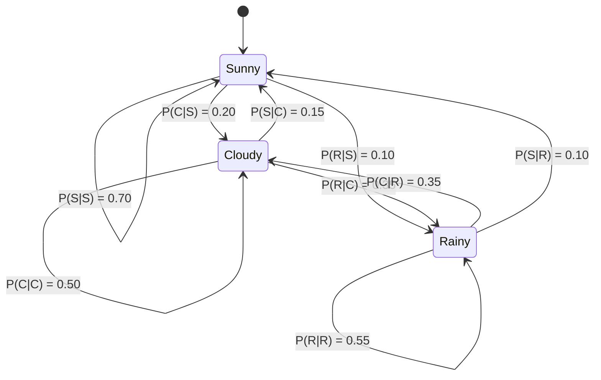

# Atmospheric State Transition Predictor 🌦️

[](https://www.python.org/)
[](https://streamlit.io/)
[]()
[]()
[](https://opensource.org/licenses/MIT)

> **Probabilistic weather sequence forecasting and regime transition modeling implemented using Hidden Markov Models (HMM) and maximum-likelihood decoding via the Viterbi algorithm.**

---

## 📌 Executive Overview

Weather systems exhibit strong temporal dependencies and non-deterministic state dynamics. Traditional deterministic classifiers evaluate snapshots in isolation, missing underlying atmospheric regimes. 

This system models atmospheric transitions as a **First-Order Markov Process** governed by unobserved latent states. Given discrete sequential observations (such as humidity indices or surface moisture indicators), the model calculates:
1. **State Transition Probabilities ($A$):** The stochastic transition likelihood between discrete weather regimes ($\text{Sunny} \leftrightarrow \text{Cloudy} \leftrightarrow \text{Rainy}$).
2. **Emission Likelihoods ($B$):** The probability distribution of physical surface observations conditioned on latent atmospheric states.
3. **Optimal Path Decoding:** Computing the globally most probable hidden state sequence over a 7-day forecast horizon via dynamic programming (**Viterbi Algorithm**).

---

## 🏗️ State Transition Architecture



---

## 🧠 Mathematical Formulation

The Hidden Markov Model is formalized as the tuple $\lambda = (A, B, \pi)$:

* **State Space:** $S = \{s_1: \text{Sunny}, s_2: \text{Cloudy}, s_3: \text{Rainy}\}$
* **Observation Space:** $V = \{v_1: \text{Dry}, v_2: \text{Damp}, v_3: \text{Saturated}\}$
* **Transition Matrix ($A$):** $A_{ij} = P(q_{t+1} = s_j \mid q_t = s_i)$
* **Emission Matrix ($B$):** $B_{jk} = P(o_t = v_k \mid q_t = s_j)$
* **Initial Probability Vector ($\pi$):** $\pi_i = P(q_1 = s_i)$

### Viterbi Path Optimization
To compute the most probable hidden state sequence $Q^* = (q_1^*, q_2^*, \dots, q_T^*)$ for an observation sequence $O = (o_1, o_2, \dots, o_T)$:

$$\delta_t(j) = \max_{1 \le i \le N} \left[ \delta_{t-1}(i) \cdot A_{ij} \right] \cdot B_j(o_t)$$

The optimal sequence is recovered via backward pointer backtracking from $t = T$ down to $t = 1$.

---

## ✨ Features

- **Interactive State Transition Matrix:** Real-time visual heatmaps of state change likelihoods.
- **Dynamic Observation Ingestion:** Input multi-day observational sequences to simulate real-world sensor streams.
- **7-Day Viterbi Horizon Decoding:** Forecasts the single most probable trajectory of hidden meteorological regimes.
- **Streamlit Control Dashboard:** Clean, interactive UI for scenario experimentation and probability threshold exploration.

---

## 🛠️ Tech Stack

- **Language:** Python 3.10+
- **Statistical Modeling:** `hmmlearn`, `scipy`, `numpy`
- **Data Engineering:** `pandas`
- **Visualization & UI:** `streamlit`, `matplotlib`, `seaborn`

---

## 🚀 Quick Start (Local Setup)

### 1. Clone the repository
```bash
git clone https://github.com/Jyotiraditya1006/Weather-HMM-Predictor.git
cd Weather-HMM-Predictor
```

### 2. Set up virtual environment
```bash
python -m venv venv
# Windows:
.\venv\Scripts\activate
# Linux/macOS:
source venv/bin/activate
```

### 3. Install dependencies
```bash
pip install -r requirements.txt
```

### 4. Launch the Streamlit application
```bash
streamlit run app.py
```
Open **[http://localhost:8501](http://localhost:8501)** in your browser to interact with the model.

---

## 📜 License
Distributed under the MIT License. See [LICENSE](LICENSE) for more details.
